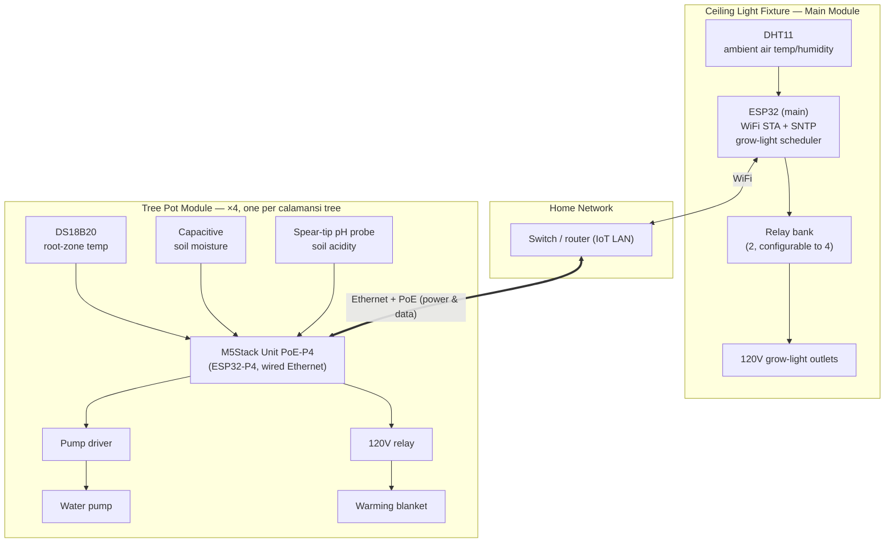

GPIO for 

## Project Layout
* `src/` — the active firmware (ESP-IDF project), under development now.
* `samples/relay-demo/` — the original single-relay blink/wifi/sntp demo, left working as reference (see its own README's "Learnings" section for the relay wiring gotchas discovered there).
* `samples/gists/` — a reference ESP32 web-relay-control Arduino sketch, kept for ideas toward a future web-managed schedule.
* `vendor/` — untracked, local-only: full ESP-IDF checkout, Arduino ESP32 core, ESPAsyncWebServer. Used for building/reference, not shipped.
* `pot/` — ESP-IDF project for the Unit PoE-P4 tree-pot module (target `esp32p4`). Currently a minimal bring-up build (boot + serial log only, confirming the toolchain/flash pipeline) — Ethernet and sensors come next.
* `scripts/deploy.sh` — rsyncs the repo to the Pi ("watering-can", USB-attached) and builds/flashes a given project there; defaults to `src/` on `esp32`, override with `PROJECT_DIR`/`TARGET` env vars (e.g. `PROJECT_DIR=pot TARGET=esp32p4`) for `pot/`; see the script header for the rest of the overridable env vars (remote host/path, ESP-IDF export.sh location, serial port).

## System Diagram
One main module in the ceiling light fixture; one module per tree pot for sensing and local water/heat control. The pot modules are wired Ethernet + PoE (M5Stack Unit PoE-P4 — 3 owned, 1 more to buy) rather than WiFi, since the garage they'll run in already has a switch and dedicated Ethernet runs.

## Roadmap
Building this iteratively since only a couple of dev boards are wired up at a time — each phase gets flashed and tested on real hardware before moving to the next.

1. **Grow light scheduling** — `src/` has a first pass: 2 relays (configurable up to 4) driving 120V grow-light outlets on a daily on/off schedule (Kconfig-configurable hours/minutes), reusing the WiFi+SNTP time sync proven in the demo. **Status: validated on hardware.**
2. **Tree sensor monitoring** — temperature, moisture, and acidity per calamansi tree, for up to 4 trees (configurable). Sensor hardware now picked (see Hardware below). `pot/`'s toolchain/flash/boot, Ethernet+PoE connectivity (DHCP-assigned IP over the RJ45/PoE port), and the capacitive soil moisture sensor are all **validated on hardware** — moisture is now calibrated to a 0-100% scale (air=dry/0%, submerged=wet/100%, moist soil landing at ~59% in between) and logged alongside raw/mV. DS18B20 (temp) is now owned (driver not yet written); the DFRobot pH sensor isn't purchased yet.
3. **Automatic watering** — trigger a water pump relay when a tree's moisture reading is low.
4. **Root warming** — trigger a relay for a 120V warming blanket when a tree's root-zone temperature is cold.
5. **Remote schedule management** — a small web service (ESPAsyncWebServer is vendored as a candidate) to configure schedules/thresholds without a reflash.

## TODOs
* fully isolate ESP32 from relay/mains side (see [Learnings](#learnings))
* verify the Unit PoE-P4's Hat2-Bus pin mapping in `hardware_bom.md` against the schematic — RMII/Ethernet and GPIO19 (moisture) are now both confirmed correct in practice (link-up/DHCP, and moisture readings that actually respond to wet vs. dry), but the remaining Hat2-Bus pins earmarked for DS18B20/pH/relays are still just sourced from M5Stack's docs page, not cross-checked against the schematic
* re-check the moisture calibration bounds (`WC_POT_MOISTURE_RAW_DRY`/`_WET` in `pot/main/Kconfig.projbuild`) once this sensor's actually been through a real dry-out cycle in the pot, not just air/water -- adjust if bone-dry soil reads outside the current air-calibrated 0% bound
* validate one Unit PoE-P4 node end-to-end at the sensors stage before wiring up the other 3
* pilot the recommended soil pH sensor on one tree before buying 4 more at ~$99 each (see `hardware_bom.md`)
* add a voltage divider for the pH sensor's 0–4V output before wiring to the ESP32 ADC (max 3.3V input)
* water pump relay + plumbing
* warming blanket relay + wiring
* housing for esp32s and sensors?
  * electrical box?
  * 3D print???
  * lots of electrical tape????
  * waterproof enclosures specifically for the 4 pot modules (near soil/water)
* configuration file / web service for schedule + thresholds (see Roadmap #5)
* think about water management / flooding

## Learnings
* GPIO silkscreen labels on this board match the actual GPIO numbers 1:1 (e.g. the pin printed "D25" is GPIO25) — confirmed by watching a multimeter toggle in sync with the serial log while the firmware ran. An earlier comment assuming an off-by-one ("GPIO is n-1") was wrong.
* The relay module needs 5V on VCC to power the coil driver. Pulling the VCC/JD-VCC jumper to give the coil its own dedicated supply works, but the module only has one shared GND pin (no separate GND for JD-VCC) — that dedicated supply's ground still has to tie into the same ground as the ESP32/Pi/module, or the coil has no return path. Misleading failure mode: the opto-isolator LED still lights even when the coil circuit is broken this way. Keeping the jumper in place is the simplest correct wiring unless true isolation gets implemented (see TODO above).
* `esp_netif_sntp_start()` only kicks off SNTP syncing in the background -- it does not block. `wifi_time_init()` was returning immediately after starting it, so the very first schedule check in `app_main()` ran against the unsynced post-boot clock (epoch 0 UTC == Dec 31 1969 19:00:00 in EST) a good 5-8 seconds before the real sync callback fired, logging a wrong decision (and briefly actuating the wrong relay state, if the real and unsynced times happened to disagree on ON/OFF). Fixed by having `wifi_time_init()` call `esp_netif_sntp_sync_wait()` and actually block (up to a 15s timeout) until the first sync completes before returning.
* The relay is active-LOW: driving IN LOW energizes it (COM switches NC → NO); HIGH or floating at boot leaves it de-energized. The firmware's "ON"/"OFF" log labels are currently inverted relative to this.
* DHT11 only measures ambient air temperature/humidity — it doesn't substitute for root-zone soil temperature or soil moisture, both of which need their own per-tree sensors (DS18B20 and a capacitive moisture sensor, respectively).
* The Unit PoE-P4 (ESP32-P4) has no USB-UART bridge chip — its OTG/firmware-download USB-C port uses the chip's native USB-Serial/JTAG, which Linux exposes as `/dev/ttyACM0`, not `/dev/ttyUSBx` like the CP2102/CH340-based ESP32 boards. `scripts/deploy.sh --pot` defaults to `ttyACM0` for this reason.
* If a board powers on (status LED lit) but nothing shows up under `ls /dev/ttyUSB* /dev/ttyACM*` at all, suspect a charge-only USB-C cable before anything else — some cables (especially ones bundled for power banks) carry power but no data lines. This was the actual cause the first time the pot module "wasn't detected."
* `pot/`'s esp32p4 build defaults to assuming 2MB flash unless `CONFIG_ESPTOOLPY_FLASHSIZE_16MB` is set, even though the board has 16MB — harmless for a small binary but worth setting correctly up front (now in `pot/sdkconfig.defaults`).
* Ethernet on `pot/` worked first try using the esp32p4 EMAC pin defaults ESP-IDF itself ships (`ETH_ESP32_EMAC_DEFAULT_CONFIG()`) plus the generic example's default PHY address (1) — link up, DHCP-assigned IP, all confirmed on hardware. Nice case of two independent sources (M5Stack's docs + ESP-IDF's own defaults) agreeing before ever touching real hardware.
* `idf.py set-target <target>` always runs a `fullclean` first (wiping `sdkconfig` and the whole build cache), even if the target isn't actually changing. `scripts/deploy.sh` now checks the existing `sdkconfig` and only calls `set-target` when the target actually differs — otherwise every single deploy was silently forcing a full rebuild, `--flash-only` included.
* ESP-IDF's modern ADC API (`esp_adc` component, `adc_oneshot_*`) has an `adc_oneshot_io_to_channel(io_num, &unit, &channel)` helper that resolves a plain GPIO number to its ADC unit/channel — handy for making the sensor GPIO a Kconfig option (`WC_POT_MOISTURE_ADC_GPIO`) instead of hardcoding a channel enum. On esp32p4, ADC1 covers GPIO16–23 and ADC2 covers GPIO49–54 (`soc/adc_channel.h`); the Hat2-Bus header's GPIO19–23 all fall in ADC1's range, which is presumably not a coincidence.
* First attempt at wiring the moisture sensor to GPIO19 actually had its signal line on the Hat2-Bus header's GND/3.3V pins instead (misread the silkscreen) — the giveaway in the serial log was a raw ADC reading pegged at the exact max (4095) with zero sample-to-sample jitter, plus a calibrated mV figure (3949) that exceeds the ADC's real 3.3V ceiling. A genuinely floating or sensor-driven pin almost always shows at least a little noise; a reading that's both perfectly constant *and* physically impossible is a strong sign the pin is tied directly to a rail, not wired to the sensor at all. Worth remembering for the pH sensor's wiring later.
* Calibrated the moisture sensor using air (driest, raw≈2780-2834) and fully-submerged-in-water (wettest, raw≈1461-1495) as the two endpoints, rather than air + bone-dry soil — the sensor can't actually distinguish "no medium" from "bone-dry medium" since both have near-identical dielectric properties, so air is the standard "dry" reference point for this sensor type, not just a stand-in for it. Moist potting soil measured ~2000-2024 raw, landing at ~59% on this calibration -- a sane mid-range result.
* Adding a new Kconfig option (`Kconfig.projbuild`) doesn't reliably trigger ESP-IDF's own config regeneration on the next `idf.py build` here -- the build kept compiling against a stale `sdkconfig.h` missing the new `CONFIG_*` define, surfacing as an "undeclared identifier" compile error nowhere near the actual cause. Likely rsync-preserved mtimes confusing the Pi's mtime-based rebuild check. `scripts/deploy.sh` now always runs `idf.py reconfigure` before `idf.py build` (cheap, and unlike `set-target` it doesn't fullclean or touch existing sdkconfig values) so this can't silently recur.

## Hardware
Full itemized parts list with quantities, costs, and purchase links lives in [`hardware_bom.md`](hardware_bom.md), kept up to date as decisions get made. Summary:

### Development / Prototype BOM
* LAFVIN ESP32 basic starter kit (ESP32 dev board, dual relay module, breadboard, jumper wires) — owned
* Breadboard power supply module — owned
* DHT11 temperature/humidity sensor — owned (×1, ambient air near the light fixture)
* Raspberry Pi ("watering-can") — used to flash/monitor the ESP32 over USB
* 1× capacitive soil moisture sensor (v2.0.0) — owned, wired into `pot/` via ADC
* 1× DS18B20 waterproof probe (DROK) — owned, driver not yet written
* Still needed to prototype phases 2–4: 1× soil pH sensor, 1× small water pump, 1× 120V warming blanket/heat mat

### Production BOM (4 trees + 1 light fixture)
* 1× main ESP32 module (ceiling fixture)
* 1× relay bank for grow lights (2–4 channels)
* 4× pot controller modules — M5Stack Unit PoE-P4 (3 owned, 1 to buy)
* 4× each of: DS18B20 probe, capacitive soil moisture sensor, soil pH sensor, water pump + driver, 120V relay + warming blanket
* Enclosures: 1 for the ceiling module, 4 waterproof enclosures for the pot modules

See [`hardware_bom.md`](hardware_bom.md) for the itemized version with costs and links.
